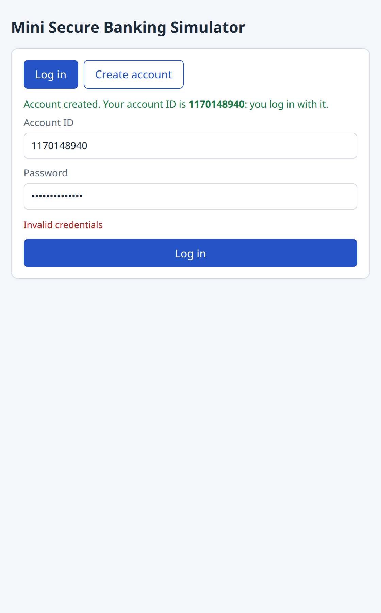
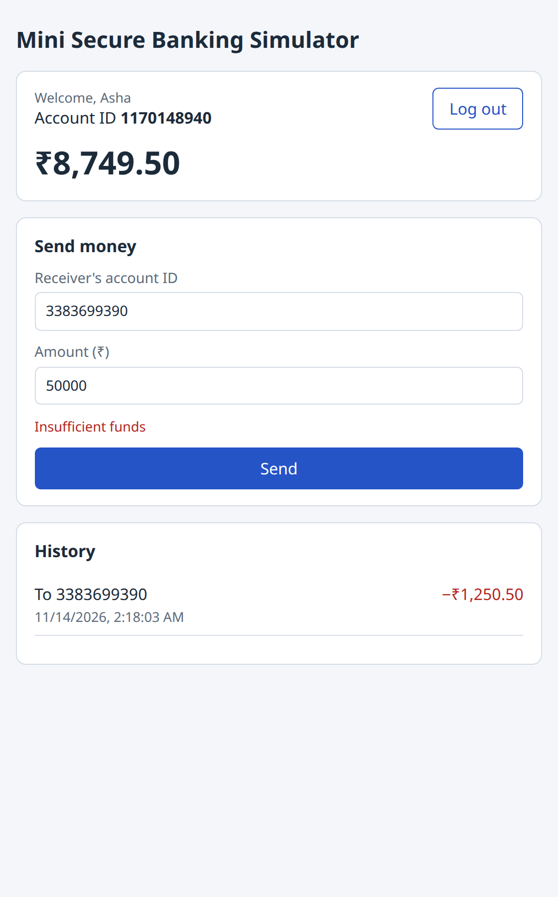
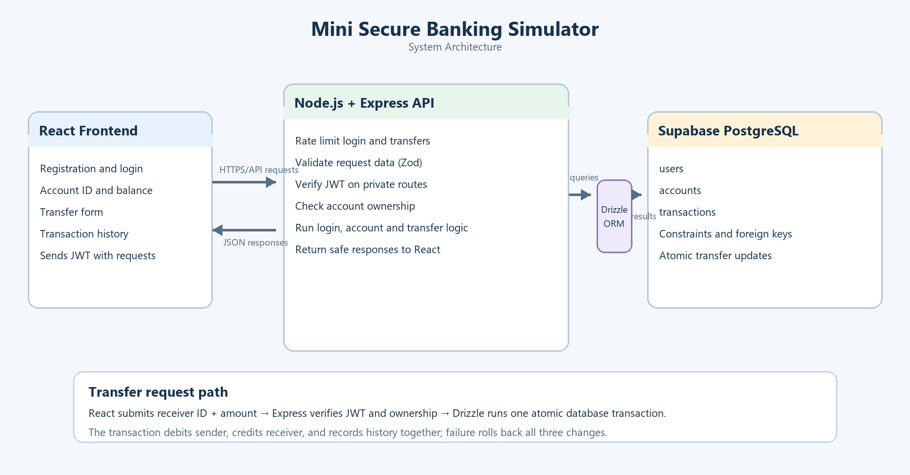

# Mini Secure Banking Simulator

A small virtual-money bank built to practise secure coding. People register, log in with an account ID, see their
balance and history, and send money to other accounts. Every step is built around a known way banking apps go wrong:
account guessing, other users' data, invalid amounts, duplicate clicks, half-finished transfers, leaked secrets.

**Stack:** React · Node.js + Express · PostgreSQL (Supabase-compatible) through Drizzle ORM · Zod · JWT ·
express-rate-limit · Argon2id

<p>
  
  
</p>

## Architecture



React talks only to the Express API. Express rate-limits, validates every request with Zod, verifies the JWT on
private routes, and works out the user from the token, never from IDs in the request. Drizzle runs each transfer as
one database transaction. PostgreSQL enforces the money rules a second time with constraints and a trigger.

**Tables:** `users(id, display_name, password_hash, created_at)`,
`accounts(id, owner_user_id → users, account_id, balance, created_at)`,
`transactions(id, sender_account_id → accounts, receiver_account_id → accounts, amount, request_key, created_at)`.
Each user has one account. Money is whole paise in `BIGINT` columns and travels as decimal strings in JSON, so
nothing is ever rounded.

## Each security requirement, where it's enforced, and the test that proves it

| Requirement | How | Test (`server/test/`) |
|---|---|---|
| **Login** without guessable accounts | Random unique 10-digit account IDs. Passwords hashed with Argon2id. The same `Invalid credentials` for a wrong password and an unknown account, in about the same time (a dummy hash is checked when there is no account). | `auth.test.js` |
| **Rate limiting** | Login: 20 per 15 min per address, and only 5 *failed* attempts per address and account. Registration: 10 per hour. Transfers: 10 per minute per user. | `rateLimits.test.js` |
| **Privacy** of accounts and history | Private routes need a JWT. Its signature, `HS256` algorithm, issuer, audience and 15-minute expiry are all checked. Queries are keyed by the token's user ID; no route takes an account ID to read, and history shows the other side's account ID only. | `access.test.js` |
| **Amount validation** | Whole paise as a string: no sign, fraction, exponent or leading zero, and at most ₹1,00,000. `-500`, `0`, `12.5`, `1e3` and `999999999999999999` are refused. Database `CHECK`s repeat the rules. | `transfers.test.js` |
| **Consistent transfers, no duplicates** | One database transaction locks both accounts (in a fixed order, so there are no deadlocks), checks funds, debits, credits and records history. Any failure rolls all of it back. A client-generated `requestKey` is unique per sender, so a retry or double click returns the first transfer. The UI also disables the button while a transfer is being sent. | `transfers.test.js`: 20 simultaneous transfers from a balance that covers 10 succeed exactly 10 times; 10 copies of one request run once |
| **Input limits** | `maxLength` on every input in React, the same limits again in Zod, strict schemas that reject unknown fields (`balance`, `fromAccountId`, …), and a 10 KB body limit. | `auth.test.js`, `transfers.test.js` |
| **Database and secrets** | Parameterized queries through Drizzle only. Row Level Security on every table, with no policies, so Supabase's public API roles see nothing. The JWT secret and database URL live in server-side environment variables. | `transfers.test.js` (constraints hold even for direct SQL) |
| **History and errors** | History rows are created inside the transfer and a trigger blocks `UPDATE`, `DELETE` and `TRUNCATE`. Users get generic errors; logs get the error name and code, never bodies, passwords, tokens or SQL text. | `transfers.test.js`, `auth.test.js` |
| **Browser safety** | React renders all user input as text. The token is kept in memory only (no `localStorage`) and sent in a header, not a cookie, so there is no CSRF to defend. History is paged, 50 at most per request. | `access.test.js` (paging) |

## Run it

You need Node.js 20+ and Docker.

```bash
docker compose up -d --wait                 # PostgreSQL on 127.0.0.1:5433

cd server
npm install
cp .env.example .env                        # then set JWT_SECRET (the file says how to make one)
node --env-file=.env src/db/migrate.js      # create the tables
node --env-file=.env src/index.js           # API on http://localhost:3000

cd ../client                                # in another terminal
npm install
npm run dev                                 # open http://localhost:5173
```

Every new account starts with ₹10,000.00 of virtual money, so two accounts are enough to try transfers.

**Tests:** with the database running, `cd server && npm test`. They create a fresh `msbs_test` database each run,
apply the migrations, and test the real API and database (24 tests). CI runs them against a PostgreSQL service
container.

**Supabase:** set `DATABASE_URL` to your project's connection string (the server's, kept secret) and run the
migration. The app needs nothing Supabase-specific; Row Level Security keeps the tables closed to Supabase's public API.

## API

| Method | Path | Auth | Body / query |
|---|---|---|---|
| `POST` | `/api/auth/register` | — | `{ displayName, password }` → `{ accountId }` |
| `POST` | `/api/auth/login` | — | `{ accountId, password }` → `{ token, expiresIn }` |
| `GET` | `/api/account` | JWT | → `{ accountId, displayName, balance, createdAt }` |
| `POST` | `/api/transfers` | JWT | `{ toAccountId, amount, requestKey }` → `{ transfer, replayed }` |
| `GET` | `/api/transactions` | JWT | `?limit=1..50&before=<id>` → `{ items, nextCursor }` |

## Limits of this simulator

- Rate limits are counted in memory, so they apply per server process; several instances would need a shared store
  such as Redis.
- There are no refresh tokens. A session lasts 15 minutes, and reloading the page logs out.
- Logging out clears the token in the browser; the token itself stays valid until it expires.
- No administrator role, as designed: demo data is managed directly in the database.
